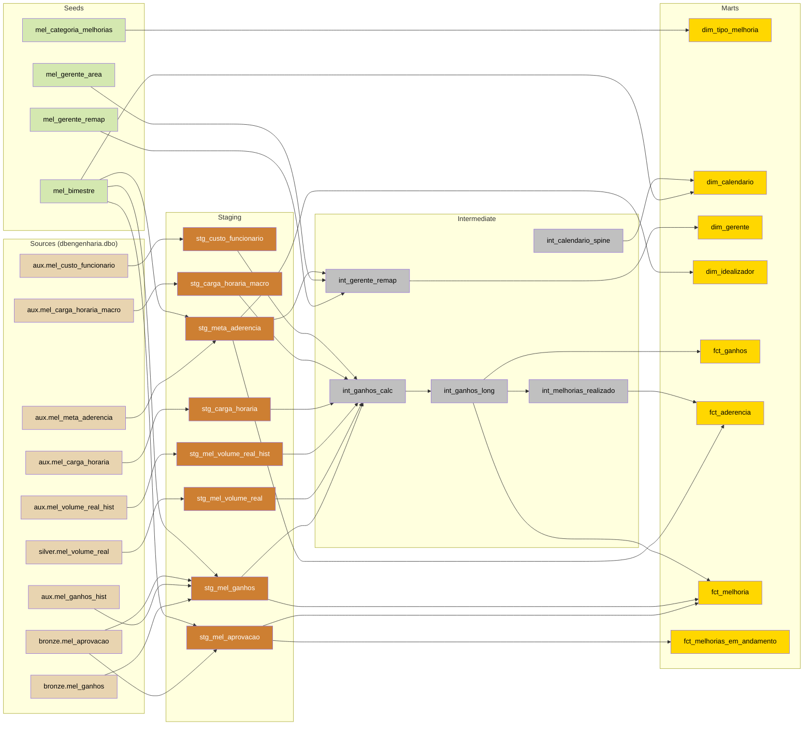
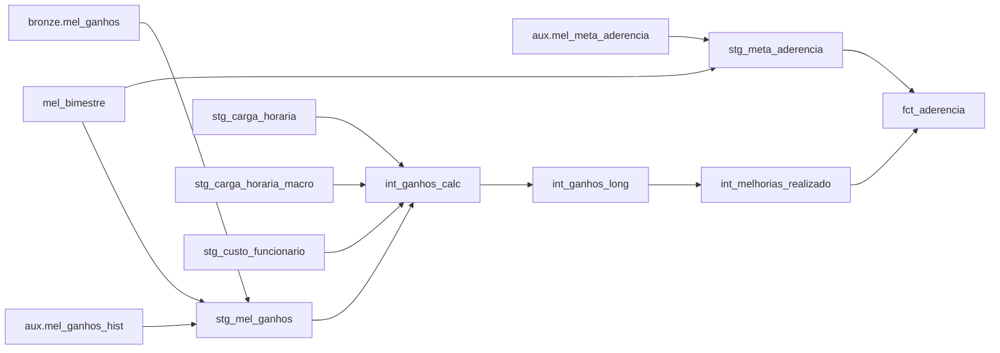
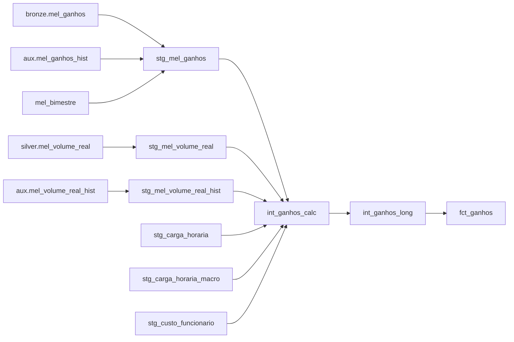
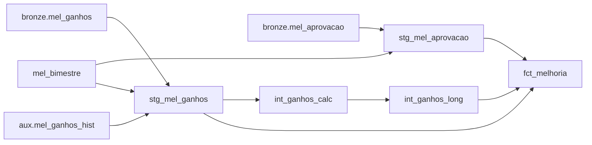
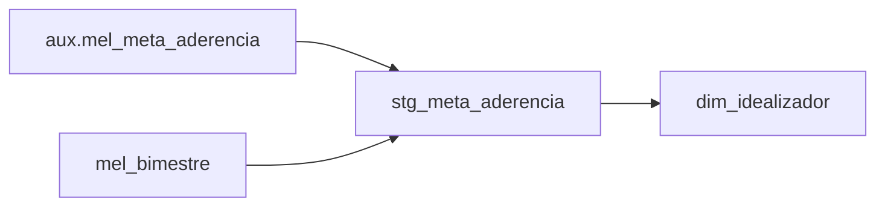
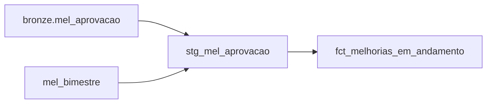
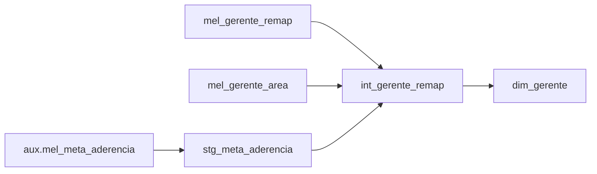

# Linhagem de dados — dbt melhorias

Fluxo de dados do projeto dbt `melhorias`, da origem (SQL Server `dbengenharia`) até os
fatos e dimensões de consumo do Power BI. Arquitetura medallion:
**Sources → Staging → Intermediate → Marts**.

A linhagem aqui é derivada do `target/manifest.json` (gerado no build do dbt) — fonte
canônica das dependências `ref()`/`source()`. Para regenerar após mudanças nos modelos,
rode o dbt (build/compile) e atualize este documento conforme o novo manifest.

> ADR 0001: todos os modelos são materializados como **VIEW** no schema `dbo`
> (limite de 10 GB, import do Power BI). Seeds também vivem em `dbo`.

## Diagrama global

## Diagramas focados por fato

Subgrafos de impacto: o que muda quando se altera um upstream de cada fato.

### fct_aderencia — meta × realizado (roster completo)

Grão (bimestre, crachá idealizador). Cruza a meta (roster completo, elegíveis e
não-elegíveis) com o realizado de melhorias por idealizador (left join).

### fct_ganhos — caminho de ganhos LONG

Uma linha por (FAP, mês de competência 1..4). Conversão para R$ por tipo em
`int_ganhos_long` (ADR 0003).

### fct_melhoria — resumo por FAP

Uma linha por FAP (roster completo, todos os status). Junta aprovação (`status`,
`tipo_produto`, `tipo_melhoria`) com o ganho agregado por FAP (`ganho_reais` R$ de
`int_ganhos_long`, `replicacao`/`origem_melhoria` de `mel_ganhos`, por left join).

### dim_idealizador — roster da meta

Sai direto do roster da meta (`stg_meta_aderencia`, tabela central).

**Chave de relação Power BI (`sk_idealizador`).** O Power BI (import) só relaciona por
chave de 1 coluna, mas o grão do idealizador é composto `(bimestre, crachá)`. Por isso
`dim_idealizador` expõe `sk_idealizador = concat(bimestre, '|', crachá)` como PK de 1
coluna (dimensão-ponte), e os fatos `fct_aderencia`/`fct_ganhos`/`fct_melhoria` expõem a
mesma chave como FK. Relação correta é fato → `dim_idealizador` (não fato-a-fato). `collate
database_default` no concat resolve o conflito de collation (`fct_ganhos.cracha` Latin1
× seed UTF8). `fct_melhorias_em_andamento` fica de fora (não tem bimestre, ADR 0003).

### fct_melhorias_em_andamento — pipeline em andamento

Melhorias com `status = 'Em andamento'`. Fora dos fatos de aprovadas (ADR 0003).
Carrega o status/nome dos aprovadores de cada etapa do fluxo.

### dim_gerente — remap + área

## Modelos

Todos materializados como `view` em `dbo`.

| Modelo | Camada | Upstream imediato | Descrição |
|---|---|---|---|
| stg_mel_aprovacao | staging | bronze.mel_aprovacao, mel_bimestre | Limpeza 1:1 do bronze; deriva `dt_fap` (aprovado e nulo → `dt_aprovacao_eng`, ADR 0003) e bimestre canônico. |
| stg_mel_ganhos | staging | bronze.mel_ganhos, aux.mel_ganhos_hist, bronze.mel_aprovacao, mel_bimestre, mel_ganhos_ajuste, mel_macro_setor, mel_ganhos_fonte_planilha | Limpeza 1:1 do bronze + `union all` com `mel_ganhos_hist` (FAPs aprovadas cujo ganho só existe nas planilhas do Qlik; campos sem equivalente completados por `mel_aprovacao`), coluna `fonte` = bronze\|hist, fontes disjuntas por FAP (ADR 0008). `dt_fap` nativo → bimestre direto. `ganho_previsto` trocado nas FAPs de `mel_ganhos_ajuste` (ADR 0011); `macro_setor` nulo preenchido por `mel_macro_setor` (ADR 0012). FAP de `mel_ganhos_fonte_planilha` sai do bronze e vem do hist, com os atributos da FAP do bronze (ADR 0013). |
| stg_mel_volume_real | staging | silver.mel_volume_real | Limpeza 1:1 do volume real por melhoria. Grão (numero_fap, cod_prod, mes_ano 'MM/YYYY'). |
| stg_mel_volume_real_hist | staging | aux.mel_volume_real_hist | Limpeza 1:1 do volume real 2021-2025 das planilhas do Qlik. Grão (numero_fap, cod_prod sem zeros à esquerda, mes_offset 1\|2), ADR 0007. |
| stg_meta_aderencia | staging | aux.mel_meta_aderencia, mel_bimestre | Limpeza 1:1; tabela CENTRAL — grão (bimestre, crachá). Deriva flag `elegivel` e bimestre canônico. |
| stg_carga_horaria | staging | aux.mel_carga_horaria | Limpeza 1:1 das horas trabalhadas mensais por setor. |
| stg_carga_horaria_macro | staging | aux.mel_carga_horaria_macro | Limpeza 1:1 das horas trabalhadas mensais por estabelecimento + macro setor (planilha do Qlik, ADR 0006). |
| stg_custo_funcionario | staging | aux.mel_custo_funcionario | Limpeza 1:1 do custo mensal por estabelecimento. |
| int_ganhos_calc | intermediate | stg_mel_ganhos, stg_mel_volume_real, stg_mel_volume_real_hist, stg_carga_horaria, stg_carga_horaria_macro, stg_custo_funcionario | Cálculo de ganhos ainda WIDE (meses 1..4 em colunas). Usa **volume real**, não mais o estimado `volume_mes_*`: competência (dt_fap + n-1 meses) antes do corte `volume_hist_ate` lê `mel_volume_real_hist` por mes_offset; depois, `mel_volume_real` por numero_fap+cod_prod+mes_ano (ADR 0007); fallback zero quando não há linha. Resolve `ch_mensal` (macro antes do corte `volume_hist_ate`; setor com fallback macro depois, ADR 0006) e `custo` do mês de `dt_base`. |
| int_ganhos_long | intermediate | int_ganhos_calc | Ganhos LONG: uma linha por (FAP, mês 1..4) com `ganho_reais` convertido por tipo (ADR 0003). |
| int_calendario_spine | intermediate | — | Date spine manual (compatível com SQL Server 2008; evita WITH aninhado do dbt_utils). |
| int_gerente_remap | intermediate | stg_meta_aderencia, mel_gerente_remap, mel_gerente_area | Remap de gerente (janela de data) + lookup de área; fall-through mantém gerente original. |
| int_melhorias_realizado | intermediate | int_ganhos_long | Realizado por (bimestre, crachá idealizador): FAP com `ganho_fap >= 0`. Entra no fct_aderencia. |
| dim_tipo_melhoria | mart | mel_categoria_melhorias | Dimensão de tipo de melhoria + categoria. |
| dim_calendario | mart | int_calendario_spine, mel_bimestre | Calendário diário; link dos fatos por `dt_fap`/`dt_competencia` (ADR 0003). |
| dim_gerente | mart | int_gerente_remap | Dimensão de gerente já remapeado + área. |
| dim_idealizador | mart | stg_meta_aderencia | Dimensão de idealizador; grão (bimestre, crachá) — atributos variam por bimestre. PK de relação BI `sk_idealizador` (bimestre\|crachá). |
| fct_ganhos | mart | int_ganhos_long | Fato de ganhos LONG por (FAP, mês 1..4); `ganho_reais` em R$. Chaveado em (bimestre, crachá) via `sk_idealizador` → dim_idealizador. |
| fct_aderencia | mart | stg_meta_aderencia, int_melhorias_realizado | Fato único de meta × realizado (roster completo, elegíveis e não). Grão (bimestre, crachá idealizador); relaciona por `sk_idealizador`. |
| fct_melhoria | mart | stg_mel_aprovacao, int_ganhos_long, stg_mel_ganhos | Fato resumo por FAP (grão 1/FAP): aprovação (`status`, `tipo_produto`, `tipo_melhoria`) + ganho agregado (`ganho_reais` R$, `replicacao`, `origem_melhoria`). Todas as FAPs/status; relaciona por `sk_idealizador`. |
| fct_melhorias_em_andamento | mart | stg_mel_aprovacao | Pipeline de melhorias em andamento (`status = 'Em andamento'`). Referenciada por `created` (ADR 0003). |

## Sources

`bronze` e `aux` são **source names do dbt** (agrupamento lógico por origem do dado),
**não schemas** — todas as tabelas vivem no schema físico `dbengenharia.dbo`. A notação
`bronze.mel_ganhos` segue a convenção dbt `source_name.tabela` (= `source('bronze',
'mel_ganhos')`), que resolve para `dbengenharia.dbo.mel_ganhos`. `bronze` = ingerido das
listas SharePoint pelas DAGs Airflow; `silver` = tabelas materializadas por DAGs Airflow
(não-dbt), ex.: volume real; `aux` = populado via planilha + VBA (sem DAG).
Ver ADR 0002 (conexão eng via env var).

| Source | Relation | Descrição |
|---|---|---|
| bronze.mel_aprovacao | `dbengenharia.dbo.mel_aprovacao` | Fluxo de aprovação/assinatura das melhorias (FAP/FAO). |
| bronze.mel_ganhos | `dbengenharia.dbo.mel_ganhos` | Ganhos das melhorias (TC, consumo, troca MP, outros). |
| silver.mel_volume_real | `dbengenharia.dbo.mel_volume_real` | Volume real de produção por melhoria (numero_fap, cod_prod, mes_ano); carregado pela DAG SILVER_MELHORIAS_VOLUME_REAL. |
| aux.mel_meta_aderencia | `dbengenharia.dbo.mel_meta_aderencia` | Meta por gerente/bimestre + roster RH elegível. |
| aux.mel_carga_horaria | `dbengenharia.dbo.mel_carga_horaria` | Carga horária mensal por setor. |
| aux.mel_ganhos_hist | `dbengenharia.dbo.mel_ganhos_hist` | Linhas de ganho (grão da planilha nos tipos com volume, uma por FAP nos demais, com `ganho_previsto` = `Ganho mês R$`) das FAPs aprovadas sem nenhuma linha em `mel_ganhos` e das FAPs de `mel_ganhos_fonte_planilha` (ADR 0013), das planilhas `BASE_LANCAMENTO` do Qlik; carga via `dags/melhorias/scripts/ganhos_hist.py`, ADR 0008. |
| aux.mel_volume_real_hist | `dbengenharia.dbo.mel_volume_real_hist` | Volume real 2021-2025 por melhoria (numero_fap, cod_prod, mes_offset), das planilhas `BASE_LANCAMENTO` do Qlik; linha sem código de tipo com volume fica com `cod_prod` = `SEM_CODIGO` (ADR 0013); carga via `dags/melhorias/scripts/volume_real_hist.py`, ADR 0007. |
| aux.mel_carga_horaria_macro | `dbengenharia.dbo.mel_carga_horaria_macro` | Carga horária mensal por estabelecimento + macro setor (planilha do Qlik; carga via `dags/melhorias/scripts/carga_horaria_macro.py`, ADR 0006). |
| aux.mel_custo_funcionario | `dbengenharia.dbo.mel_custo_funcionario` | Custo do funcionário mensal por estabelecimento. |

## Seeds

Carregados manualmente no SQL Server (DBeaver/SQL), não via `dbt seed`. Os CSVs em
`seeds/` ficam só como referência/contrato de schema; os `ref()` resolvem para as
tabelas `dbo.mel_*` criadas à mão. Ver ADR 0004.

| Seed | Descrição |
|---|---|
| mel_bimestre | Mapa mês (1-12) → bimestre (jan-fev .. nov-dez). |
| mel_categoria_melhorias | Mapa Tipo de Melhoria → Categoria (planilha). |
| mel_gerente_remap | Remap de gerente (cadeia `if` do Qlik): origem → destino, com `valido_ate` opcional. |
| mel_gerente_area | Lookup de área pelo nome do gerente já ajustado (planilha gerentes). |
| mel_ganhos_ajuste | Ganho em R$ corrigido pela planilha, por FAP de tipo sem volume (ADR 0011). |
| mel_macro_setor | Mapa (filial, setor) → macro setor para linhas de ganho sem `macro_setor` (ADR 0012). |
| mel_ganhos_fonte_planilha | FAPs de TC, Consumo e Troca MP com cadastro incompleto ou divergente: o ganho vem das linhas da planilha em `mel_ganhos_hist` (ADR 0013). |
